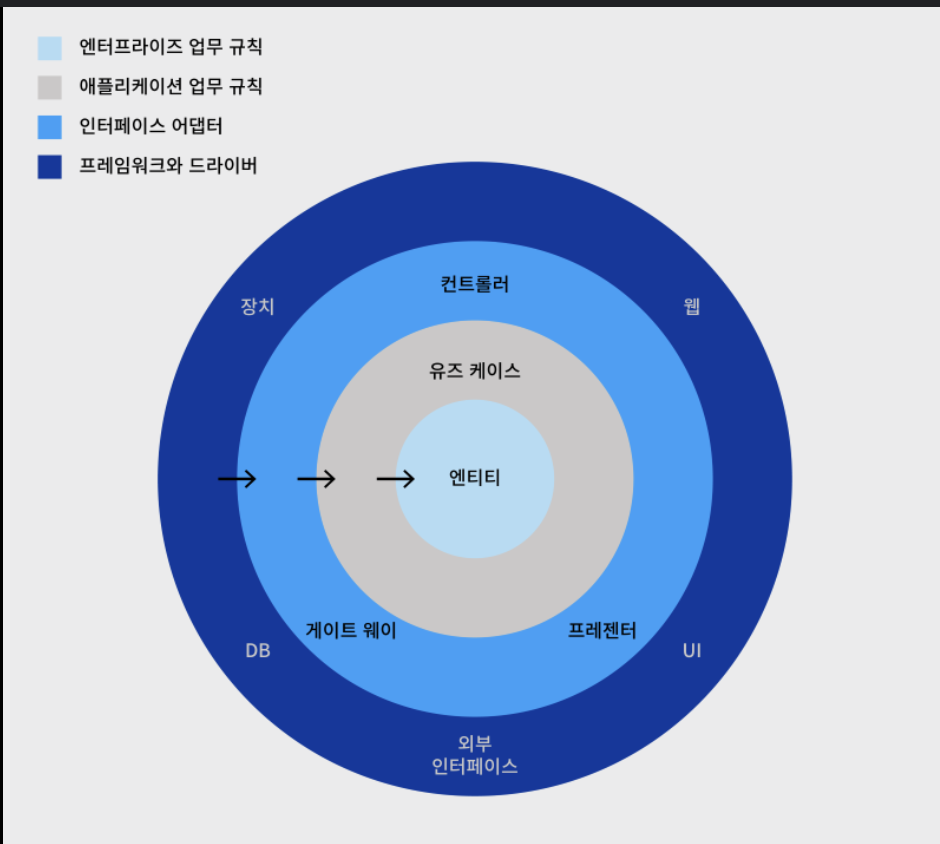
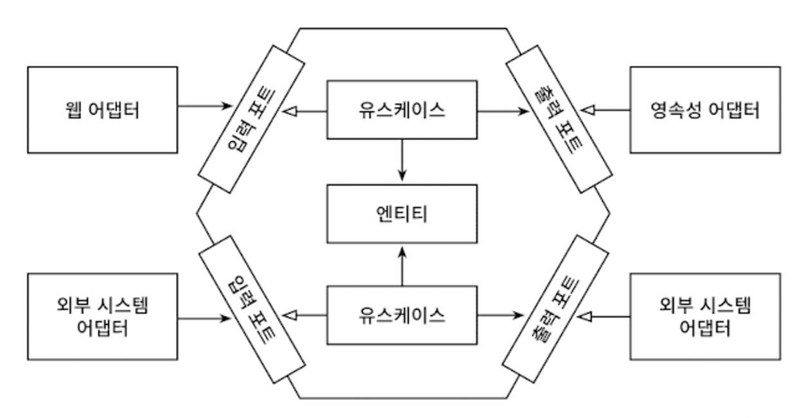

# 단일 책임 원칙

SRP : 하나의 컴포넌트는 오로지 한 가지 일만 해야 하고, 그것을 올바르게 수행햐아 한다. (= 컴포넌트를 변경하는 이유는 오직 한자기뿐이어야 한다.)

만약 컴포넌트를 변경할 이유가 한 가지라면 우리가 어떤 다른 이유로 소프트웨어를 변경하더라도 이 컴포넌트에 대해서는 전혀 신경 쓸 필요가 없다.

예를 들어, A라는 컴포넌트가 B, C, D, E라는 컴포넌트를 의존하고 있는 경우, 새로운 요구사항에 추가 시, 많은 것들이 변경되거나 다른 컴포넌트에도 영향을 줘야한다. 

하지만 E라는 컴포넌트가 의존하고 있는 컴포넌트가 없는 경우, E 컴포넌트에 대해서만 변경을 해주면 된다.

# 부수효과에 관한 이야기

1개의 컴포넌트를 수정했더니, 다른 컴포넌트들이 영향을 받는 것

# 의존성 역전 원칙

DIP : 코드상의 어떤 의존성이든 그 방향을 바꿀 수(역전시킬 수) 있다.

의존성은 양쪽 코드 모두 제어가 가능할 때 의존성을 역전시킬 수 있다. 만약 서드파티 라이브러리의 경우 우리가 라이브러리를 제어할 수 없기 때문에 의존성을 역전시킬 수 없다.

의존성 역전은 어떻게 동작할까?

- 도메인 코드와 영속성 코드 간의 의존성을 역전시켜서 영속성 코드가 도메인 코드에 의존하고, 도메인 코드를 `변경할 이유`의 개수를 줄여보자.
- 엔티티는 도메인 객체를 표현하고 도메인 코드는 이 엔티티들의 상태를 변경하는 일을 중심으로 하기 때문에 먼저 엔티티를 도메인 계층으로 올린다.
- 그러나 영속성 계층의 레포지토리가 도메인 계층에 있는 엔티티에 의존하기 때문에 두 계층 사이에 `순환 의존성`이 생긴다.
- 이 부분이 DIP를 적용해야 하는 부분이다. 도메인 계층에 레포지토리에 대한 이터페이스를 만들고, 실제 레포지토리는 영속성 계층에서 구현하게 하는 것이다.

# 클린 아키텍처

도메인 코드가 바깥으로 향하는 어떤 의존성도 없어야 한다. 대신 의존성 역전 원칙의 도움으로 모든 의존성이 도메인 코드를 향하고 있다.

- 클린 아키텍처에서 가장 중요한 것은 의존성 규칙이다. 계층 간의 모든 의존성이 안쪽으로 향해야 한다.
- 클린 아키텍처 중심에는 도메인 엔티티가 있다. 유스케이스는 서비스라고 벌렀던 것들인데, 단액 책임을 갖기 위해 조금 더 세분화돼 있다. 이를 통해 넓은 문제를 해결할 수 있다.
- 이 코어(엔티티)를 중심으로 다른 모든 컴포넌트들을 확인할 수 있다.

> 하지만 클린 아키텍처에는 대가가 따른다. 도메인 계층이 영속성이나 UI 같은 외부 계층과 철저하게 분리돼야 하므로 APP의 엔티티에 대한 모델을 각계층에서 유지보수해야 한다.

ORM을 사용한다고 하자. 일반적으로 ORM 프레임워크는 DB 구조 및 객체 필드와 DB 컬럼의 매핑을 서술한 엔티티 클래스를 필요로 한다.

하지만 클린 아키텍처에서는 모데인 계층은 영속성 계층을 모르기 때문에 도메인 계층에서 사용한 엔티티 클래스를 영속성 계층에서 함께 사용할 수 없고, 두 계층에서 각각 엔티티를 만들어야 한다. 즉, 도메인 계층과 영속성 계층이 데이터를 주고받을 때 두 엔티티를 서로 변환해야 한다는 뜻이다. 이는 도메인과 다른 계층들 사이도 마찬가지다.

하지만 도메인 코드를 ORM에 의존적인 상태의 문제인 결합 상태를 제거한 것이다. 가령 Java Persistence API에서는 ORM이 관리하는 엔티티에 인자가 없는 기본 생성자를 추가하도록 강제한다.

# 육각형 아키텍처(헥사고날 아키텍처)

육각형 안에는 도메인 엔티티와 이와 상효작용하는 유스케이스가 있다. 육각형에서 외부로 향하는 의존성이 없다.

- 모든 의존성은 코어를 향한다
- 육각형 바깥에는 APP과 상효작용하는 다양한 어댑터들이 있다. 웹 어댑터, 등등
- APP 코어와 어댑터들 간의 통신이 가능하려면 APP 코어가 각각의 포트를 제공해야 한다. Driving 어댑터에는 호출하는 포트번호와 같은 정보가 구현될 것이고, Driven 어댑터에는 호출되는 인터페이스가 구현될 것이다.

ports-and-adapters 아키텍처라고도 불린다.

# 유지보수 가능한 소프트웨어를 만드는 데 어떻게 도움이 될까?

클린 아키텍처, 육각형 아키텍처, 등등 의존성을 역전시켜 도메인 코드가 다른 바깥쪽 코드에 의존하지 않게 함으로써 영속성과 UI에 특화된 모든 문제로부터 도메인 로직의 결합을 제거하고 코드를 변경할 이유의 수를 줄일 수 있다.

- 변경할 이유가 적을수록 유지보수성은 더 좋아진다